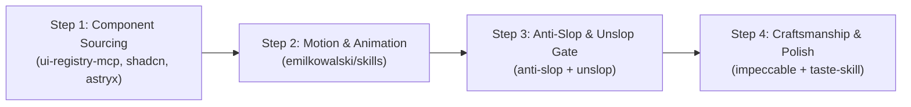

# UI, UX, Anti-Slop & Motion Design Standards

> **Layer 2 Modular Rule** | Trigger: `**/*.{tsx,jsx,vue,svelte,css,scss,html}`, UI component creation, frontend design

This document establishes the mandatory sequential 4-step UI/UX development pipeline, anti-slop filters, motion physics budgets, and component registry integrations required for all user interfaces developed in this repository.

---

## 1. Mandatory 4-Step UI/UX Development Pipeline

Whenever creating or modifying web user interfaces, all agents MUST execute the following 4 steps in exact sequential order:



### Step 1: Component Sourcing (Zero-Scratch Mandate)

> **Framework note**: `ui-registry-mcp`, the shadcn CLI and Astryx emit
> **React** components. This boilerplate is framework-agnostic TypeScript and
> does not depend on React. In a React project, install them as-is. In a
> non-React project, search the registries for the design source, then adapt
> the markup and styling to the local framework — the "zero-scratch" rule
> still applies (do not invent a component from nothing), but do not add
> React to a non-React project.
- **Rule**: DO NOT author UI components from scratch.
- **Action**:
  1. Search for existing accessible component primitives and templates across:
     - `ui-registry-mcp` (searches across 12 modern registries: ReUI, Kokonut UI, Kibo UI, Cult UI, Aceternity, etc.). It is **off in the default profile** — start it with `./scripts/mcp-profile.sh ui`.
     - `shadcn mcp` (`npx shadcn@latest mcp`)
     - Meta's `@astryxdesign/cli` (`npx @astryxdesign/cli search <component>`)
  2. If a matching component or block is found, install and adapt it into `components/ui/` or the local feature folder:
     - **Named registries.** `components.json` declares two, and the shadcn CLI addresses them in the `@namespace/name` form. The key MUST carry the `@` prefix and the URL MUST contain a `{name}` placeholder, or the CLI rejects the whole file.
       ```bash
       npx shadcn@latest add @magicui/marquee
       npx shadcn@latest add @astryx/component-button
       ```
       The default shadcn registry needs no namespace: `npx shadcn@latest add button`.
     - **Astryx item names are prefixed.** The registry at `https://astryx.atmeta.com/shadcn` publishes items as `component-<name>` (`component-button`, `component-badge`, …), not `button`. List them with `npx @astryxdesign/cli component --list`.
     - **Astryx components are StyleX, not Tailwind.** Every Astryx item declares `@astryxdesign/core` and `@stylexjs/stylex` as dependencies and imports `@astryxdesign/core/reset.css` and `astryx.css`. It does not use this repository's Tailwind theme, so install it into its own folder (`components/astryx/`) and add its CSS imports — dropping it into `components/ui/` next to Tailwind components will not render.
  3. **Only if NOT found** across all three sources are you permitted to author a custom component from scratch.

### Step 2: High-Performance Motion & Animation (`emilkowalski/skills`)
- **Rule**: Apply smooth, physics-based animations to transitions and interactions.
- **Action**:
  1. Consult [`motion`](../skills/design/motion/SKILL.md) (from `emilkowalski/skills`).
  2. Use spring physics (`stiffness: 300, damping: 30, mass: 1`) for natural deceleration.
  3. Restrict animations strictly to GPU-composited properties: `transform` (translate, scale, rotate) and `opacity`. NEVER animate layout reflow properties (`width`, `height`, `top`, `margin`).
  4. Always respect `prefers-reduced-motion: reduce`.

### Step 3: Anti-Slop & Unslop Gate (`anti-slop` & `heydamir/unslop`)
- **Rule**: Eliminate generic, cliché AI aesthetics and sloppy visual patterns.
- **Action**:
  1. Consult [`antislop`](../skills/design/antislop/SKILL.md) and [`unslop`](../skills/design/unslop/skills/unslop/SKILL.md).
  2. **Ban Cliché AI Aesthetics**:
     - No generic purple/cyan radial gradient backgrounds.
     - No meaningless floating cards with gratuitous rounded borders and drop shadows.
     - No decorative sparkle/glitter/wand icons on non-generative features.
     - No buzzword-heavy corporate fluff ("seamless", "supercharge", "unleash").
  3. Verify accessibility contrast against WCAG 2.2 AA (minimum 4.5:1 for normal text).

### Step 4: Craftsmanship Polish & Taste Elevation (`impeccable` & `taste-skill`)
- **Rule**: Polish layout, typography, and visual hierarchy to senior designer standards.
- **Action**:
  1. Consult [`impeccable`](../skills/design/impeccable/SKILL.md) and apply steering verbs:
     - `polish`: Crisp 1px borders, subtle border colors, micro-spacing.
     - `bolder`: Strengthen visual hierarchy and dominant CTA prominence.
     - `quieter`: Soften secondary metadata with muted tokens.
     - `typeset`: Establish clear typographic scales (60–75 char reading widths).
     - `space`: Enforce strict 4px/8px geometric spatial scales.
  2. Apply curated palettes and type hierarchy from [`taste-skill`](../skills/design/taste-skill/skills/taste-skill/SKILL.md).

---

## 2. Related Standards & Skills
- [Core Invariants](core-invariants.md): Operational boundaries and project scoping.
- [Code Quality](code-quality.md): 400-line limit and feature-folder architecture.
- [Skills Index](skills-index.md): Complete wiring map for all integrated skills.
