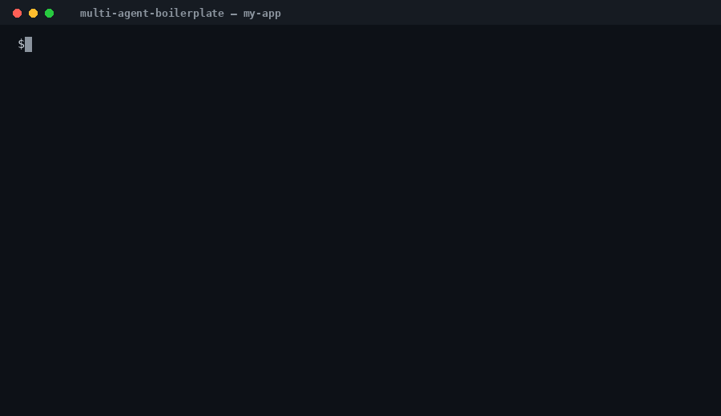

# Multi-Agent Boilerplate



**A ready-made workspace for AI coding agents — 377 curated skills, project-local guardrails and a 10-suite self-check, pre-wired into 13 agents.** Clone it, run one command, and your agent already knows how your project works.

[](LICENSE)
[](.agents/rules/skills-index.md)
[](docs/agents)
[](https://github.com/ur-sriram/boilerplate/discussions)
[](https://github.com/ur-sriram/boilerplate/stargazers)
[](https://github.com/ur-sriram/boilerplate/network/members)

**[Live demo →](https://ur-sriram.github.io/boilerplate/)** · [Contributing](CONTRIBUTING.md) · [Changelog](CHANGELOG.md) · [Discussions](https://github.com/ur-sriram/boilerplate/discussions) · [Issues](https://github.com/ur-sriram/boilerplate/issues)

---

## Table of contents

1. [What you get](#1-what-you-get)
2. [Quick start (one command)](#2-quick-start-one-command)
3. [How to use it day to day](#3-how-to-use-it-day-to-day)
4. [The slash commands](#4-the-slash-commands)
5. [How the pieces fit together](#5-how-the-pieces-fit-together)
6. [Your project's folder layout](#6-your-projects-folder-layout)
7. [Using it with different agents](#7-using-it-with-different-agents)
8. [Configuring things](#8-configuring-things)
9. [Making it yours](#9-making-it-yours)
10. [When something goes wrong](#10-when-something-goes-wrong)
11. [Contributing to this repo](#11-contributing-to-this-repo)
12. [License and credits](#12-license-and-credits)

---

## 1. What you get

| | Feature | Why it helps |
|---|---|---|
| 🧠 | **377 skills, each with a "how to use it" rule** | Instead of your agent improvising, it loads a proven workflow (TDD, debugging, code review, UI polish, git safety…). Every skill is listed with its governing rule in [`.agents/rules/skills-index.md`](.agents/rules/skills-index.md). |
| 📏 | **Project rules that load on demand** | 7 short rule files instead of one giant prompt. Your agent reads only the ones the task needs, so it stays fast. |
| 🛡️ | **Guardrails that actually run** | A hook blocks any file write outside the project folder, on Windows, macOS and Linux — and the project's own package caches stay inside the project too. |
| 📝 | **Plan before you code** | Spec-driven templates (`.specify/`) plus 8 slash commands like `/plan` and `/tdd` turn "build me X" into a written spec, plan and task list. |
| 🧩 | **Works with 13 AI agents** | Claude Code, Cursor, Codex, Copilot, OpenCode, Junie, Kimi, Goose, Qoder, Windsurf, Cline, Antigravity, Freebuff — same rules, same skills, same commands in each. 12 of them are checked automatically by `scripts/verify-adapters.py`. |
| ✅ | **A test suite that checks the repo itself** | 10 checks run in seconds: scripts parse, links resolve, files are under 400 lines, every agent has the same capabilities, the skill map is current. If something drifts, you find out immediately — in CI and on your machine. |
| 🧠 | **Cross-session memory that actually persists** | Decisions, preferences and error recoveries are recorded in `.agents/memory/` and recalled by a hook when the next session starts — a local, project-scoped store, no external service, secrets scrubbed on write. |
| 🚧 | **Sensible defaults for quality** | Strict TypeScript, a 400-line file cap, TDD as the default, a 4-step UI pipeline, and a "no secrets, no global writes" constitution. |

**What it deliberately does NOT do:** touch your global config. Nothing is
written to `~/.claude`, `%APPDATA%`, `~/.config`, `~/.cache` or anywhere
outside the project folder — not even the package caches:

- every MCP server is pinned to the project-local `.cache/` directory
  (`UV_CACHE_DIR`, `UV_DATA_DIR`, `UV_TOOL_DIR`, `XDG_*`, `npm_config_cache`),
- `npm install` uses the project `.npmrc`, so even npm's cache stays in,
- the one exception is the self-test sandbox, which lives in the system temp
  directory and is deleted when the run ends.

This is verified, not just claimed: `scripts/verify-adapters.py` fails the
build if any adapter's MCP servers stop pinning the project-local cache.
Everything is reversible — delete the folder and it's gone.

---

## 2. Quick start (one command)

### One command — Linux / macOS

```bash
gh repo create my-project --template ur-sriram/boilerplate --clone && cd my-project && ./scripts/bootstrap.sh
```

That creates your repo from the template, clones it and wires up every agent's
skill links in one go.

### One command — Windows

```powershell
gh repo create my-project --template ur-sriram/boilerplate --clone; cd my-project; bootstrap.cmd
```

### Or do it by hand

```bash
# 1. Get the code
git clone https://github.com/ur-sriram/boilerplate.git my-project
cd my-project

# 2. Set it up (creates the skill links your agent needs)
./scripts/bootstrap.sh          # macOS / Linux
bootstrap.cmd                   # Windows (Command Prompt)
powershell -NoProfile -ExecutionPolicy Bypass -File ./scripts/bootstrap.ps1   # Windows (PowerShell)

# 3. Check everything works
./scripts/verify-all.sh         # macOS / Linux
verify-all.cmd                  # Windows
```

You should see this:

```
 1. verify-tools           [PASS]
 2. verify-scripts         [PASS]
 3. verify-file-limits     [PASS]
 4. verify-links           [PASS]
 5. sync-agent-adapters    [PASS]
 6. test-bootstrap         [PASS]
 7. skills-index           [PASS]
 8. verify-adapters        [PASS]
 9. specify-integrity      [PASS]
10. opencode-plugins      [PASS]
============================================================
 ALL VERIFICATION SUITES PASSED (100% GREEN)
============================================================
```

### Step 4 — Install the project tools (optional, but recommended)

```bash
npm install     # installs TypeScript, ESLint and the test runner
npm test        # runs the example feature's tests
npm run lint    # checks code style + the 400-line limit
npm run typecheck
```

### Step 5 — Open it in your agent

Point your agent at the project folder. It reads `AGENTS.md` automatically, and
from then on the rules, skills and commands are available.

### Want to see it first?

The **[live demo](https://ur-sriram.github.io/boilerplate/)** walks through the
same flow in the browser — the layered architecture, the agent list, the
verification suite and the one-command install.

---

## 3. How to use it day to day

### The shortest possible loop

```
1. Describe what you want     →  "Add a dark mode toggle"
2. Agent plans it              →  /plan  (writes spec.md, plan.md, tasks.md)
3. Agent builds it             →  /tdd   (failing test first, then code)
4. Agent checks itself         →  /verify (runs all 10 suites)
5. Agent reviews the diff      →  /review
```

### Paste this into any agent's first message

```text
You are an AI coding agent working in this repository.

1. Read `AGENTS.md` at the project root first — it is the short index of every
   rule and skill you should use.
2. Run `./scripts/verify-all.sh` (or `verify-all.cmd` on Windows) before you
   start. All 10 suites must pass.
3. Before writing code for a new feature, run `/plan`. It creates the spec,
   plan and task files under `specs/<number>-<name>/`.
4. For implementation, use `/tdd` — write a failing test first, watch it fail,
   then make it pass.
5. Before you finish, run `/verify` and `/review`.
6. Never write outside this project folder. Never commit secrets.
```

### Asking for a feature, the way you'd ask a colleague

| You say | The agent does |
|---|---|
| "Add a settings page" | Reads the skills index, finds the relevant skills, plans the feature in `specs/`, then implements it test-first |
| "This test is failing" | Loads the systematic-debugging skill: reproduce → isolate → hypothesise → minimal fix with a regression test |
| "Make this component look better" | Follows the 4-step UI pipeline: reuse an existing component → add motion → anti-slop check → polish |
| "Review my changes" | Two-stage review: correctness & security, then simplicity & the 400-line limit |
| "Clean this up" | Surgical simplification only — no drive-by refactors, no reformatting |

---

## 4. The slash commands

Type `/` in your agent's chat. All eight work in every supported adapter.

| Command | What it does |
|---|---|
| `/plan` | Turns your request into a written spec, plan and task list under `specs/<number>-<name>/` |
| `/tdd` | Runs a strict red → green → refactor cycle |
| `/test` | Runs the tests and shows the failing ones |
| `/review` | Two-stage code review (correctness & security, then simplicity) |
| `/simplify` | Simplifies code without changing behaviour |
| `/refactor-clean` | Removes dead code and splits files over 400 lines |
| `/verify` | Runs the full 10-suite verification suite |
| `/build-fix` | Diagnoses and fixes build or type errors |

---

## 5. How the pieces fit together

```
┌─ ALWAYS LOADED ──────────────────────────────────────────────┐
│  AGENTS.md        ← the short index (<= 1,000 tokens)         │
└───────────────────────────────┬───────────────────────────────┘
                                │ points to
┌─ LOADED WHEN NEEDED ──────────▼─────────────────────────────┐
│  .agents/rules/    ← 7 short rule files                       │
│    planning-standards · code-quality · ui-standards ·         │
│    core-invariants · automation · codebase-exploration ·      │
│    mcp-codemode                                              │
└───────────────────────────────┬───────────────────────────────┘
                                │ points to
┌─ LOADED ON DEMAND ───────────▼───────────────────────────────┐
│  .agents/skills/   ← 377 skills, each with a governing rule   │
│  .specify/         ← spec-driven development templates        │
└──────────────────────────────────────────────────────────────┘
```

**Why the layering?** An AI agent's context window is expensive. This setup
keeps the always-loaded part tiny (one short file) and pulls in the heavy
material only while a task actually needs it. That is why your agent stays
quick instead of reading 50,000 lines of instructions on every message.

**The three layers in plain English:**

- **AGENTS.md** — the "table of contents". Always in context. Points to everything else.
- **.agents/rules/** — the "how we do things here" files. 7 of them, each loaded when relevant.
- **.agents/skills/** — the "how-to" library. 377 detailed procedures, loaded one at a time.

---

## 6. Your project's folder layout

```
my-project/
├── AGENTS.md              ← agent index (always loaded)
├── CLAUDE.md              ← Claude Code entry point
├── .agents/
│   ├── rules/             ← 7 rule files + the skill wiring map
│   ├── skills/            ← 377 skills (the big library)
│   ├── commands/          ← the 8 slash commands (source of truth)
│   ├── mcp.json           ← MCP server definitions
│   └── memory/            ← cross-session memory (claude-mem store) (claude-mem store)
├── .specify/              ← spec-driven development (Spec Kit)
├── specs/                 ← your feature specs (created by /plan)
├── .planning/             ← live task state (task_plan, findings, progress)
├── src/features/          ← your actual code, one folder per feature
├── scripts/               ← bootstrap + verification scripts
├── docs/                  ← per-agent setup guides + assets
└── package.json           ← npm test / lint / typecheck
```

**Where to put your code:** one folder per feature under `src/features/`.
Copy the example:

```bash
cp -r src/features/_template src/features/my-feature
```

Each feature folder holds `feature.ts` (logic), `feature.types.ts` (types),
`feature.test.ts` (tests), `index.ts` (exports) and a `README.md`.

---

## 7. Using it with different agents

Every agent gets the same rules, skills, MCP servers and commands. Per-agent
setup guides live in [`docs/agents/`](docs/agents):

| Agent | Setup guide |
|---|---|
| Claude Code | [claude.md](docs/agents/claude.md) |
| OpenCode | [opencode.md](docs/agents/opencode.md) |
| Cursor | [cursor.md](docs/agents/cursor.md) |
| Codex CLI | [codex.md](docs/agents/codex.md) |
| GitHub Copilot | [copilot.md](docs/agents/copilot.md) |
| Antigravity | [antigravity.md](docs/agents/antigravity.md) |
| Qoder | [qoder.md](docs/agents/qoder.md) |
| Kimi Code CLI | [kimi.md](docs/agents/kimi.md) |
| Goose | [goose.md](docs/agents/goose.md) |
| JetBrains Junie | [junie.md](docs/agents/junie.md) |
| Cline / Roo Code | [cline.md](docs/agents/cline.md) |
| Windsurf | [windsurf.md](docs/agents/windsurf.md) |
| Freebuff | [freebuff.md](docs/agents/freebuff.md) |

You can check that every adapter is still wired correctly at any time:

```bash
python3 scripts/verify-adapters.py
```

---

## 8. Configuring things

### MCP servers (the tools your agent can call)

Three servers are available: `graphify` (codebase search), `ui-registry`
(component lookup) and `headroom` (output compression). Only `graphify` is on
by default, to keep your agent's context small. Switch profiles with:

```bash
./scripts/mcp-profile.sh core          # graphify only (default)
./scripts/mcp-profile.sh ui             # + component lookup
./scripts/mcp-profile.sh compression    # + output compression
./scripts/mcp-profile.sh all
./scripts/mcp-profile.sh --status       # see what is active now
```

On Windows: `powershell -ExecutionPolicy Bypass -File ./scripts/mcp-profile.ps1 ui`

The switcher updates **every** agent's config at once, so they never disagree.

A configured server is not a working server — one entry sat in all nine
configs for months while crashing on startup. Prove they boot:

```bash
python3 scripts/verify-mcp-servers.py           # boot every server, list its tools
python3 scripts/verify-mcp-servers.py graphify  # just one
```

### The project constitution (your rules of the house)

[`.specify/memory/constitution.md`](.specify/memory/constitution.md) holds the
non-negotiables: strict project scoping, no committed secrets, TDD, the
400-line limit, the skill-wiring rule. Edit it to add your own rules — it is
your project's constitution, and the plan template has a "Constitution Check"
section that forces the agent to honour it.

### Agent rules

The seven rule files in `.agents/rules/` are plain Markdown. Read one, edit
one. `code-quality.md` is a good starting point for your own conventions.

---

## 9. Making it yours

| I want to… | Do this |
|---|---|
| Add my own rules | Add a file in `.agents/rules/`, reference it from `AGENTS.md` |
| Add a skill | Create `.agents/skills/<name>/SKILL.md` with YAML frontmatter (`name`, `description`), then run `python3 scripts/generate-skills-index.py` |
| Change the spec templates | Drop an override in `.specify/templates/overrides/` — it wins over the built-in template |
| Add a feature | `cp -r src/features/_template src/features/<name>` and start at `feature.test.ts` |
| Change the slash commands | Edit `.agents/commands/*.md`, then run `./scripts/sync-agent-adapters.sh` to push them to every agent |
| Change the file-size limit | Update `MAX_LINES` in `scripts/verify-file-limits.sh` **and** `scripts/verify-file-limits.ps1` (keep them identical), plus `eslint.config.js` |
| Check nothing drifted | `./scripts/verify-all.sh` |

Two habits worth keeping:

1. **Run `./scripts/verify-all.sh` before you commit.** It catches broken
   links, oversized files, missing rules and adapter drift in seconds.
2. **Never edit the files under `.agents/skills/`** — they are vendored
   third-party content. Put your own skills in a new folder.

---

## 10. When something goes wrong

| Symptom | Fix |
|---|---|
| `verify-all` says a skill junction is missing | Run `./scripts/sync-agent-adapters.sh` (Windows: `scripts\sync-agent-adapters.ps1`) |
| Your agent says it has no skills | Same command — the junctions are what give it access to `.agents/skills/` |
| "Skill wiring" check fails after adding a skill | Run `python3 scripts/generate-skills-index.py` to regenerate the index |
| "Adapter parity" check fails | Run `python3 scripts/verify-adapters.py` — it prints exactly which adapter lost what |
| Agent ignores the 400-line limit | Make sure `npm install` has been run so ESLint is available |
| `~/.npm` or `~/.cache` grows after setup | The project-local cache env was dropped from an adapter config — run `python3 scripts/verify-adapters.py` to find which one |
| Everything feels slow / context too big | Switch back to the core MCP profile: `./scripts/mcp-profile.sh core` |
| Hook blocks a write you expected to be allowed | The path resolved outside the project root — check whether it is a symlink; the guardrail compares physical paths |
| `npm test` finds no tests | Tests live in `src/features/**/*.test.ts` — add one per feature |

---

## 11. Contributing to this repo

Contributions are welcome, including first ones. The whole contribution
guide — how to set up, the rules the CI enforces, and how to get a PR merged —
lives in [CONTRIBUTING.md](CONTRIBUTING.md). Issues labelled
[good first issue](https://github.com/ur-sriram/boilerplate/issues?q=label%3A%22good+first+issue%22)
are a good place to start.

Questions that are not bugs? Ask them in
[Discussions](https://github.com/ur-sriram/boilerplate/discussions).

---

## 12. License and credits

All original code, rules and scripts are MIT licensed — see [LICENSE](LICENSE).
Third-party skills and tools (Superpowers, Spec Kit, Impeccable, Agency
personas, and 15 more) are catalogued with pinned commit SHAs, licences and
adaptation notes in [THIRD_PARTY.md](THIRD_PARTY.md).

Every release is listed in [CHANGELOG.md](CHANGELOG.md).
